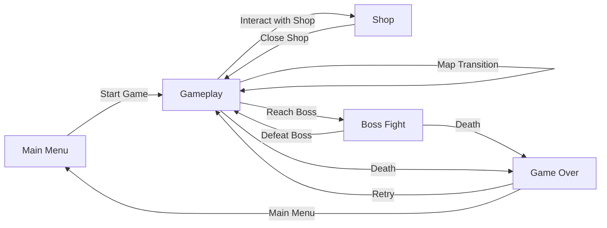
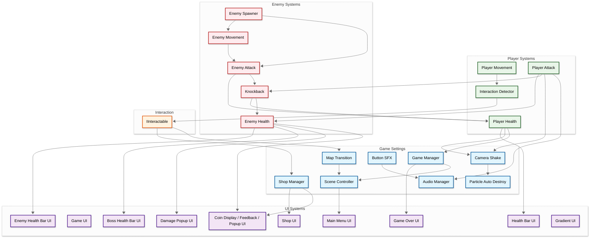
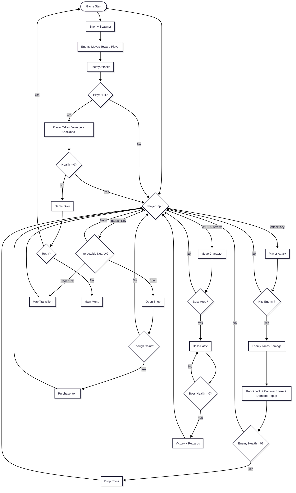

## Developer & Contributions
Jevon (Game Programmer)

## About
Slime Slayer is a 2D action adventure game where players explore connected maps, fight off waves of enemies, collect coins, and take on powerful bosses. Spend your hard-earned coins at the shop to get stronger, interact with the world around you, and survive increasingly dangerous encounters. Every hit is backed by knockback, camera shake, and damage popups to make combat feel punchy and readable.

 

## Key Features

**Action Combat System**: Attack enemies with responsive player combat, with knockback, hit feedback, and damage popups on every strike. Enemies chase and attack, so positioning and timing matter.

**Coin Economy & Shop**: Defeat enemies to earn coins, with animated coin popups and a live coin display. Spend them in the shop to upgrade and prepare for tougher fights.

**Boss Encounters**: Face bosses with dedicated boss health bars that raise the stakes of every major fight.

**Exploration & Interaction**: Move between maps through transitions and interact with objects and characters using a flexible interaction system.

## Scene Flow

## Layer / Module Design

## Modules and Features

The action-adventure gameplay, enemy AI, shop economy, map transitions, and UI are powered by a modular Unity C# scripting system organized into `Player`, `Enemy`, `GameSettings`, and `UI` folders.

| 📂 Name | 📁 Folder | 📋 Responsibility |
|---------|-----------|-------------------|
| **PlayerMovement** | **Player** | - Handle player movement input - Control speed and facing direction - Support animation states |
| **PlayerAttack** | **Player** | - Handle attack input - Detect and damage enemies in range - Manage attack cooldown - Trigger hit effects and sounds |
| **PlayerHealth** | **Player** | - Track player health (current/max) - Handle damage and invincibility - Trigger death and game over - Update health bar |
| **EnemyMovement** | **Enemy** | - Move enemies toward the player - Handle chase and idle behavior - Control facing direction |
| **EnemyAttack** | **Enemy** | - Attack the player when in range - Deal damage and manage cooldown - Trigger knockback on the player |
| **EnemyHealth** | **Enemy** | - Track enemy health points - Handle damage from the player - Update health bars and show damage popups - Drop coins and clean up on death |
| **GameManager** | **GameSettings** | - Manage overall game state - Handle player death and game over - Track coins and progress |
| **SceneController** | **GameSettings** | - Load and reload scenes - Handle transitions between menu and gameplay |
| **MapTransition** | **GameSettings** | - Move the player between maps - Handle spawn positions and fade transitions |
| **EnemySpawner** | **GameSettings** | - Spawn enemies in the world - Control spawn positions, timing, and limits |
| **ShopManager** | **GameSettings** | - Manage shop items and prices - Handle purchases with coins - Apply upgrades to the player |
| **InteractionDetector** | **GameSettings** | - Detect nearby interactable objects - Trigger interaction on player input |
| **IInteractable** | **GameSettings** | - Interface for interactable objects - Allow shops, doors, and NPCs to share one interaction flow |
| **Knockback** | **GameSettings** | - Push entities away on hit - Control force and duration |
| **CameraShake** | **GameSettings** | - Shake the camera on impacts - Control intensity and duration |
| **AudioManager** | **GameSettings** | - Play music and sound effects - Manage volume and audio clips |
| **ButtonSFX** | **GameSettings** | - Play sound effects on button hover and click |
| **ParticleAutoDestroy** | **GameSettings** | - Destroy particle effects after they finish - Keep the scene clean |
| **MainMenuUI** | **UI** | - Handle main menu buttons - Start game, settings, and quit |
| **GameUI** | **UI** | - Manage the in-game HUD - Coordinate UI elements during gameplay |
| **HealthBarUI** | **UI** | - Display player health - Update in real time |
| **EnemyHealthBarUI** | **UI** | - Display enemy health bars - Follow enemies in the world |
| **BossHealthBarUI** | **UI** | - Display the boss health bar - Show and hide during boss encounters |
| **CoinDisplayUI** | **UI** | - Display the current coin count |
| **CoinFeedbackUI** | **UI** | - Provide visual feedback when coins change |
| **CoinPopupUI** | **UI** | - Show floating coin popups on pickup or reward |
| **DamagePopupUI** | **UI** | - Show floating damage numbers - Animate and fade out popups |
| **ShopUI** | **UI** | - Display shop items and prices - Handle purchase buttons |
| **GameOverUI** | **UI** | - Show the game over screen - Handle retry and quit options |
| **GradientUI** | **UI** | - Apply gradient visuals to UI elements |

 

## Game Flow Chart

 

## Play The Game
<a href="https://exaltedartix.itch.io/slime-slayer">Play Now</a>

 

## Installation & Setup
1. Clone this repository
2. Open the project in Unity (version used in your project recommended)
3. Open the main menu scene
4. Press Play to start testing

## Controls
- **WASD / Arrow Keys** - Movement
- **Attack Key** - Attack
- **Interact Key** - Interact (shop, doors, objects)
- **Escape** - Pause Menu

## Credits
Game developed as a Game Programming Project Individually.

- Engine : Unity
- Assets : Free assets itch.io
